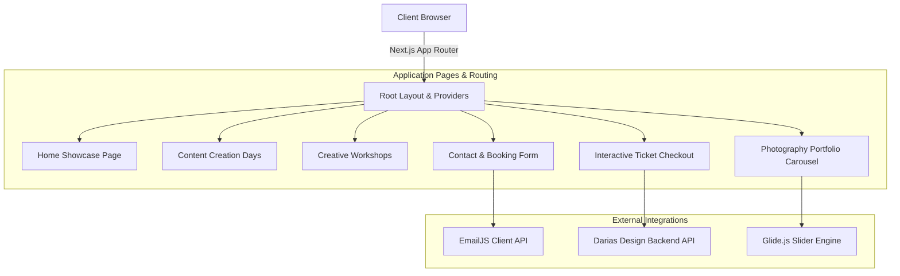

# Darias Design - Photography Workshops & Event Ticketing

<p align="center">
  
</p>

<p align="center">
  <a href="https://nextjs.org"></a>
  <a href="https://react.dev"></a>
  <a href="https://tailwindcss.com"></a>
  <a href="https://www.radix-ui.com"></a>
  <a href="https://www.emailjs.com"></a>
  <a href="https://turbo.build"></a>
  <a href="LICENSE"></a>
</p>

---

## 📖 Overview

**dariasdesign_frontend** is Darias Design Frontend (`dariasdesign_frontend`) is an elegant, modern web platform built with Next.js 15 Turbopack, React 19, and Tailwind CSS. Tailored for creative photography masterclasses, content creation workshops, and creative community events, the application features interactive ticket purchasing, rich portfolio galleries, and email inquiries.

---

## ⚡ Key Features

- 📸 **Content Creation Days & Workshops:** Dedicated event landing showcases outlining agendas, location details, guest speakers, and schedule timelines.
- 🎟️ **Interactive Ticket Reservation:** Direct attendee registration flow with ticket tier selection and participant details.
- 🖼️ **Creative Portfolio & Gallery:** High-performance responsive photography carousel utilizing Glide.js.
- 💌 **Direct Inquiry Contact with EmailJS:** Instant client messaging integrated with EmailJS for event partnerships and inquiries.
- ⚡ **Turbopack Fast Refresh:** Built with Next.js 15 App Router and React 19 for instantaneous build and page transitions.
- 📱 **Modern Responsive UI:** Polished dark/creative aesthetic crafted with Radix UI accessibility primitives and Tailwind CSS.

---

## 🏗️ System Architecture



---

## 📂 Directory Structure

```text
.
├── src/
│   ├── app/
│   ├── components/
│   └── ...
├── assets/
│   └── banner.svg
├── .env.example
├── .gitignore
├── package.json
├── README.md
└── LICENSE
```

---

## 🛠️ Tech Stack & Dependencies

| Layer / Library | Version | Description |
|---|---|---|
| **Next.js** | `v15.2 (Turbopack)` | Full-stack React framework with App Router |
| **React** | `v19.x` | Modern declarative UI component architecture |
| **Tailwind CSS** | `v3.4` | Utility-first modern styling |
| **Radix UI** | `v1.x Primitives` | Accessible, unstyled UI component primitives |
| **Glide.js** | `v3.7` | Lightweight touch-friendly carousel for visual portfolios |
| **EmailJS** | `v4.4` | Client-side email dispatch without backend relay |
| **React Hook Form** | `v7.x` | Form state management and validation |

---

## ⚙️ Environment Variables

Create a `.env` file in the project root based on the provided sample:

```bash
cp .env.example .env
```

Configurable variables:

```env
NEXT_PUBLIC_API_URL=http://localhost:5000/api/v1
NEXT_PUBLIC_EMAILJS_SERVICE_ID=your_emailjs_service_id
NEXT_PUBLIC_EMAILJS_TEMPLATE_ID=your_emailjs_template_id
NEXT_PUBLIC_EMAILJS_PUBLIC_KEY=your_emailjs_public_key
```

---

## 🚀 Getting Started

### Prerequisites

- Node.js (v20.x or higher recommended)
- Package Manager (`npm`, `yarn`, or `pnpm`)

### Installation

```bash
# Clone repository
git clone https://github.com/shahjalal-labs/dariasdesign_frontend.git
cd dariasdesign_frontend

# Install dependencies
npm install
```

### Running Locally

```bash
# Start development server
npm run dev
# or for backend services
npm run start:dev
```

### Building for Production

```bash
# Create production build
npm run build

# Start production server
npm start
```

---

## 📄 License

This project is licensed under the [ISC License](LICENSE).
